<div align="center">

<h1 align="center">
<picture>
  <source media="(prefers-reduced-motion: reduce)" srcset="assets/banner-static.svg">
  
</picture>
</h1>

<a href="#projects"></a>
<a href="#services"></a>
<a href="#skills"></a>
<a href="#blog"></a>
<a href="#contact"></a>


<a href="mailto:pavindas007@gmail.com?subject=Security%20Testing%20Inquiry"></a>
<a href="https://github.com/PavinDas/PavinDas/releases/download/Resume/PavinDas.pdf"></a>
<a href="https://pavindas.github.io"></a>

<table align="center">
<tr>
<td valign="top"></td>
<td valign="top"></td>
</tr>
</table>

**Web & Mobile Application Security Testing** · **Vulnerability Assessment & Penetration Testing** · **Secure Code Review**<br>
<sub>Security engineer and ethical hacker based in Bengaluru, India. Open to freelance work.</sub>

<a id="projects"></a>
<h2 align="center"></h2>
<table align="center">
<tr>
<td align="center" valign="top">
<a href="https://github.com/PavinDas/WiFried"></a>
<details><summary>features</summary>
<ul align="left"><li>List available Wi-Fi interfaces</li><li>Enable monitor mode &amp; scan networks</li><li>Perform deauth attacks</li><li>Capture WPA handshakes</li><li>Crack passwords using aircrack-ng</li></ul>
</details>
</td>
<td align="center" valign="top">
<a href="https://github.com/PavinDas/TrafficTrace"></a>
<details><summary>features</summary>
<ul align="left"><li>Identifies active hosts using ARP</li><li>Parses network logs for anomalies</li><li>Shows top active IPs &amp; protocols</li><li>Detects port scans &amp; exfiltration</li></ul>
</details>
</td>
</tr>
<tr>
<td align="center" valign="top">
<a href="https://github.com/PavinDas/System_Monitor"></a>
<details><summary>features</summary>
<ul align="left"><li>Monitors CPU &amp; memory usage</li><li>Logs system health details</li><li>Top 5 memory-heavy processes</li><li>Checks for system updates</li><li>Backups using rsync</li></ul>
</details>
</td>
<td align="center" valign="top">
<a href="https://github.com/PavinDas/TamperTracker"></a>
<details><summary>features</summary>
<ul align="left"><li>SHA-256 hashing for file tracking</li><li>Real-time tamper detection</li><li>Auto Jira ticket creation</li><li>Configurable monitoring intervals</li></ul>
</details>
</td>
</tr>
<tr>
<td align="center" valign="top">
<a href="https://github.com/PavinDas/NopeWare"></a>
<details><summary>features</summary>
<ul align="left"><li>Uploads files for scanning</li><li>Shows name, size &amp; SHA-256</li><li>Displays AV verdicts</li><li>Flags malicious detections</li></ul>
</details>
</td>
<td align="center" valign="top">
<a href="https://github.com/PavinDas/Subdomains_Finder"></a>
<details><summary>features</summary>
<ul align="left"><li>Custom wordlist-based discovery</li><li>Simple &amp; lightweight</li><li>Custom User-Agent support</li></ul>
</details>
</td>
</tr>
</table>

<a id="services"></a>
<h2 align="center"></h2>
<table align="center">
<tr>
<td align="center" valign="top"></td>
<td align="center" valign="top"></td>
<td align="center" valign="top"></td>
</tr>
</table>

<a id="skills"></a>
<h2 align="center"></h2>

<br>
<a href="https://www.python.org"></a>
<a href="https://www.gnu.org/software/bash/"></a>
<a href="https://developer.mozilla.org/en-US/docs/Web/JavaScript"></a>
<a href="https://dev.java"></a>
<a href="https://en.cppreference.com/w/c"></a>
<a href="https://developer.mozilla.org/en-US/docs/Web/HTML"></a>
<a href="https://developer.mozilla.org/en-US/docs/Web/CSS"></a>
<a href="https://dart.dev"></a>


<br>
<a href="https://portswigger.net/burp"></a>
<a href="https://nmap.org"></a>
<a href="https://sqlmap.org"></a>
<a href="https://github.com/ffuf/ffuf"></a>
<a href="https://www.metasploit.com"></a>
<a href="https://www.wireshark.org"></a>
<a href="https://www.zaproxy.org"></a>
<a href="https://frida.re"></a><br>
<a href="https://github.com/MobSF/Mobile-Security-Framework-MobSF"></a>
<a href="https://github.com/skylot/jadx"></a>
<a href="https://apktool.org"></a>
<a href="https://caido.io"></a>
<a href="https://github.com/lanmaster53/recon-ng"></a>
<a href="https://github.com/epsylon/xsser"></a>
<a href="https://docs.oracle.com/en/java/javase/21/docs/specs/man/jarsigner.html"></a>
<a href="https://www.torproject.org"></a>


<br>
<a href="https://en.wikipedia.org/wiki/Security_information_and_event_management"></a>
<a href="https://en.wikipedia.org/wiki/Endpoint_detection_and_response"></a>
<a href="https://en.wikipedia.org/wiki/Firewall_(computing)"></a>
<a href="https://en.wikipedia.org/wiki/Intrusion_detection_system"></a>
<a href="https://en.wikipedia.org/wiki/Malware_analysis"></a>
<a href="https://en.wikipedia.org/wiki/Virtual_private_network"></a>
<a href="https://en.wikipedia.org/wiki/Security_orchestration"></a>


<br>
<a href="https://owasp.org/www-project-top-ten/"></a>
<a href="https://www.cve.org"></a>
<a href="https://www.first.org/cvss/"></a>
<a href="https://git-scm.com"></a>
<a href="https://github.com"></a>
<a href="https://developer.android.com/tools/adb"></a>
<a href="https://developer.android.com/studio"></a>
<a href="https://www.genymotion.com"></a><br>
<a href="https://www.postgresql.org"></a>
<a href="https://www.mongodb.com"></a>
<a href="https://flask.palletsprojects.com"></a>
<a href="https://firebase.google.com"></a>
<a href="https://flutter.dev"></a>
<a href="https://www.atlassian.com/software/jira"></a>


<br>
<a href="https://www.kernel.org"></a>
<a href="https://www.android.com"></a>
<a href="https://www.microsoft.com/windows"></a>
<a href="https://www.apple.com/ios"></a>
<a href="https://www.apple.com/macos"></a>

<a id="blog"></a>
<h2 align="center"></h2>
<table align="center">
<tr>
<td align="center"><a href="https://pavindas.github.io/blogs/cia-triad.html"></a></td>
<td align="center"><a href="https://pavindas.github.io/blogs/elk-stack.html"></a></td>
</tr>
<tr>
<td align="center"><a href="https://pavindas.github.io/blogs/soc-lab.html"></a></td>
<td align="center"><a href="https://pavindas.github.io/blogs/mr-robot.html"></a></td>
</tr>
</table>

<a href="https://pavindas.github.io/blog.html"></a>
<br><sub>Also on <a href="https://medium.com/@pavin-das">Medium</a></sub>

<a id="github"></a>
<h2 align="center"></h2>

<picture>
  <source media="(prefers-color-scheme: dark)" srcset="assets/snake/github-snake-dark.svg">
  
</picture>


<a id="contact"></a>
<h2 align="center"></h2>
<p align="center">
<a href="https://github.com/PavinDas"></a>
<a href="mailto:pavindas007@gmail.com"></a>
<a href="https://linkedin.com/in/pavin-das"></a><br>
<a href="https://medium.com/@pavin-das"></a>
<a href="https://twitter.com/pavin__das"></a>
<a href="https://instagram.com/pavin__das"></a><br>
<a href="https://tryhackme.com/p/pavindas"></a>
<a href="https://pavindas.github.io"></a>
</p>

<p align="center">
<a href="mailto:pavindas007@gmail.com?subject=Security%20Testing%20Inquiry"></a><br>
<sub>Based in Bengaluru, India</sub>
</p>


<details>
<summary>$ sudo su</summary>

```console
root@security:~$ sudo su
[sudo] password for pavin: ************
root@security:~# whoami
root
root@security:~# cat /root/flag.txt
FLAG{curiosity_is_the_best_exploit}
root@security:~# exit
```

</details>

<sub>© 2026 PavinDas · <a href="#">↑ back to top</a></sub><br>
<sub>credits: Devicon · Font Awesome Free · Simple Icons · JetBrains Mono · <a href="assets/LICENSES.md">licenses</a></sub>

</div>
